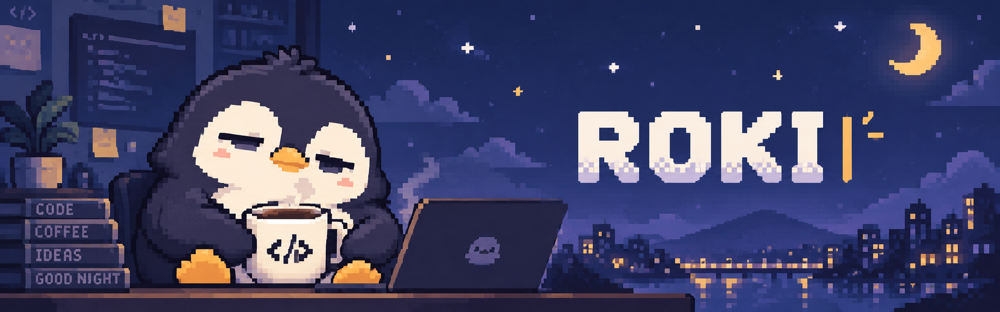
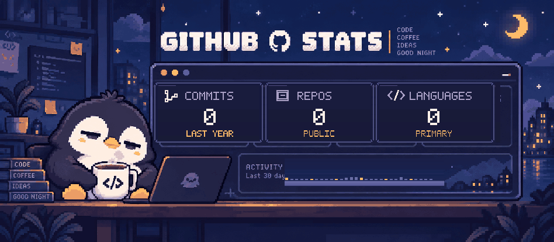

# Hi, I'm Roki

  

  <picture>
    <source media="(prefers-color-scheme: dark)" srcset="https://readme-typing-svg.demolab.com?font=Fira+Code&amp;size=18&amp;duration=3200&amp;pause=1200&amp;color=73CDE0&amp;center=true&amp;vCenter=true&amp;width=620&amp;height=42&amp;lines=Building+local+AI+systems;Creating+interactive+web+apps;Exploring+data+through+code" />
    
  </picture>

**AI · Web Development · Data Science**

Data Science student in Japan building local AI systems, web applications, and data visualization tools.

日本の大学でデータサイエンスを学びながら、AI・Webアプリ・データ可視化の個人開発に取り組んでいます。

## Featured Projects

### [Raphael — Local AI Assistant](https://github.com/Roki0i/raphael-integration)

A local AI assistant combining a Python backend with a React / Three.js interface, an Ollama-based LLM, and speech synthesis.

**Tech:** Python · React · Three.js · Electron · Ollama · SQLite

### [Steam Player Observatory](https://github.com/Roki0i/steam-research)

A browser-based visualization tool for monthly average concurrent player counts across 1,000 Steam games, developed alongside my graduation research.

**Tech:** Python · JavaScript · SVG · GitHub Actions  
[Live demo](https://roki0i.github.io/steam-research/)

### [SONOTYPE — Music Video Studio](https://github.com/Roki0i/SONOTYPE)

A browser-based editor for creating short, music-driven vertical videos with previews and MP4 export.

**Tech:** React · TypeScript · Remotion · Web Audio API  
[Live demo](https://roki0i.github.io/SONOTYPE/)

## Tech Stack

### Languages

  
  
  
  

### Web & Runtime

  
  
  
  

### Development Tools

  
  

**Other technologies:** Pandas · SQLite · React Three Fiber · Ollama · Local LLMs · AivisSpeech · GitHub Actions · Playwright

## Environments

  
  
  
  

## GitHub Stats

  

  <a href="https://github.com/Roki0i">View live contribution activity on GitHub</a>

## Current Focus

- **Local AI:** LLM integration, voice interaction, and desktop applications.
- **Web & data:** interactive interfaces, visualizations, and API integrations.
- **Engineering:** testing, maintainability, and security.
<!-- Technology icons: https://github.com/tandpfun/skill-icons -->
